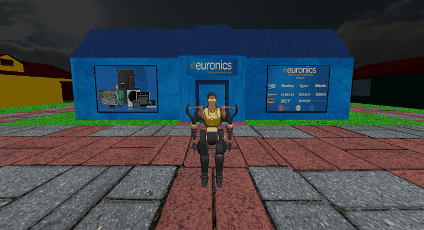
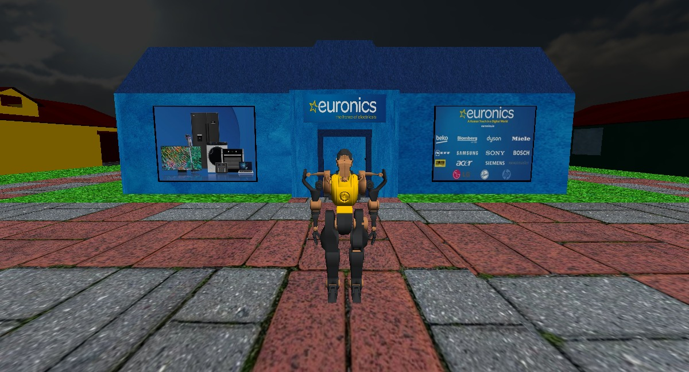
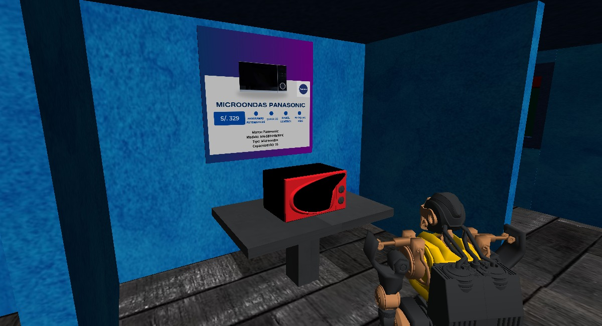

# Tienda 3D de electrodomésticos

Demo interactiva de escritorio en **C++ y OpenGL**, desarrollada por **Yanxmarcos** como proyecto final de Computación Gráfica en la Universidad Nacional de Trujillo.

Recorre una tienda con un robot articulado, alterna entre primera y tercera persona y acércate a los exhibidores para girar los productos o cambiar su variante. Cada cambio actualiza el letrero del exhibidor.



## Capturas

| Fachada y robot | Exhibidor de microondas |
| :---: | :---: |
|  |  |

## Implementación

- **Navegación y cámara** con control por ratón, avance del robot y dos perspectivas.
- **Animación articulada** de brazos y piernas con transformaciones jerárquicas en OpenGL.
- **Ocho exhibidores interactivos** con zonas de proximidad, rotación y tres variantes por categoría.
- **Escena 3D** con modelos Wavefront OBJ, materiales MTL y texturas TGA. FreeGLUT abre la ventana y gestiona las entradas.

## Compilar y ejecutar en Windows

Necesitas MinGW-w64 de 64 bits, CMake 3.24 o superior, Ninja y una conexión a Internet para la primera configuración. Se probó con el compilador incluido en Code::Blocks. Comprueba que `gcc`, `g++`, `cmake` y `ninja` estén en el PATH.

Abre PowerShell en la carpeta del proyecto y ejecuta estos comandos.

```powershell
cmake -S . -B build/release -G Ninja -DCMAKE_BUILD_TYPE=Release
cmake --build build/release
.\build\release\Tienda3D.exe
```

CMake descarga FreeGLUT 3.8.0 y lo enlaza estáticamente. Ejecuta el último comando desde la raíz para que la aplicación encuentre `modelos/` y `texturas/`. La escena puede tardar varios segundos en cargar.

## Controles

| Entrada | Acción |
| --- | --- |
| Ratón | Orientar la cámara |
| `W` | Avanzar con el robot en tercera persona |
| `C` | Alternar entre primera y tercera persona |
| `+` / `-` | Alejar o acercar la cámara en tercera persona |
| `←` / `→` | Girar el producto al entrar en la zona de un exhibidor |
| Clic izquierdo | Cambiar la variante del producto dentro de esa zona |

## Autoría y recursos

El proyecto utiliza modelos y texturas disponibles gratuitamente en Internet. Cada recurso de terceros conserva las condiciones de su licencia original. El lector OBJ conserva el crédito a Nate Robins y el cargador TGA referencia la lección 33 de NeHe.
